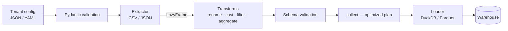

# Config-Driven Multi-Tenant ETL Framework

> A Python ETL framework where each tenant's **source, transforms and destination live
> entirely in JSON/YAML configuration** — a new tenant is onboarded by adding a config
> file, never by changing code. Built on **Polars** (lazy query plans) and **DuckDB**.


> ℹ️ **About this project:** This is an **independent reference implementation** of a
> pattern I designed and owned in production (configuration-driven, multi-tenant Python
> ETL with Polars at 10M+ records/run, 2020–2024). The original source is proprietary /
> under NDA — **no confidential code or data is used here.** This repo re-creates the
> *architecture and engineering practices* with original code and synthetic data.

---

## 📌 Overview

Serving many clients from one ETL codebase usually degrades into per-client forks. This
framework keeps **one code path** and pushes every client-specific detail — which source
to read, how to reshape it, where to land it, what schema to expect — into declarative
config. Onboarding a tenant is a pull request that adds a YAML file.

- **Domain:** Data engineering / multi-tenant analytics pipelines
- **Role modeled:** Senior Data Engineer (framework design, Polars optimization, data quality)

---

## 🏗 How it works



1. **Config is data.** Each tenant file is parsed into Pydantic models — a discriminated
   union of transform types means an unknown op or a malformed step fails fast with a
   clear error, before any data is touched.
2. **Transforms build one lazy plan.** Every step maps to a **Polars `LazyFrame`**
   operation, so the whole chain is a single query plan that Polars optimizes at
   `collect()` — intermediate results are never materialized.
3. **Schema validation** runs on the plan's schema (`collect_schema()`), catching drift
   before the load.
4. **Pluggable extractors/loaders.** Adding a source or destination is one class + one
   factory line; callers don't change.
5. **Structured JSON logging** makes every run parseable in a log aggregator.

---

## 🧩 A tenant config

```yaml
tenant: acme
source: { type: csv, path: sample_data/acme_customers.csv }
transforms:
  - { op: rename, columns: { cust_id: customer_id, full_name: name } }
  - { op: cast,   columns: { customer_id: int, revenue: float } }
  - { op: filter, column: revenue, predicate: ">", value: 1000 }
expected_schema: { customer_id: int, name: str, revenue: float }
destination: { type: duckdb, path: warehouse/acme.duckdb, table: dim_customer }
```

The `globex` tenant (see [`configs/`](configs/)) instead reads JSON, **aggregates** paid
orders by region, and lands the result in **Parquet** — same code path, different config.

---

## 🛠 Tech Stack

- **Language:** Python 3.12 (typed, OOP, design patterns — factory + strategy)
- **Dataframes:** Polars (lazy execution)
- **Warehouse:** DuckDB; also Parquet output
- **Validation:** Pydantic v2 (discriminated unions) + output schema checks
- **Config:** JSON / YAML
- **Testing:** pytest (unit + end-to-end)
- **CI:** GitHub Actions (tests + a real pipeline smoke-run)

---

## 🚀 Getting started

```bash
python -m venv .venv && . .venv/Scripts/activate   # or source .venv/bin/activate
pip install -e ".[dev]"

# Run every tenant pipeline in configs/
python -m etl --configs-dir configs
# ...or a single one
python -m etl --config configs/acme.yaml
```

Output lands under `warehouse/` (a DuckDB table for Acme, a Parquet file for Globex).

---

## ✅ Tests

```bash
pytest -q
# 12 tests: config validation, each transform, schema checks,
# and end-to-end pipelines (CSV->DuckDB, JSON->aggregate->Parquet)
```

---

## 🗺 Possible extensions

- More sources/loaders (Parquet/REST/S3 in; BigQuery/Snowflake out) behind the same factories
- Incremental / upsert load modes and partitioning
- Great-Expectations-style data-quality assertions in config
- Airflow/Dagster DAG that runs one task per tenant config

---

*This repository demonstrates architecture and engineering practices only. It contains no
proprietary source code, data, or confidential information from any employer or client.*
